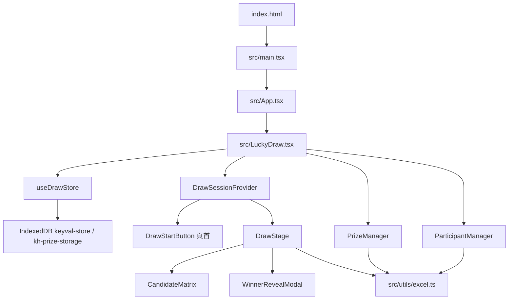

# kh-prize 平台基礎

這份文件記錄 **kh-prize** 現有的技術地基，方便下一個功能直接接上去，而不必每次重新搭框架、狀態或介面。

`README.md` 仍是 Vite 範本說明。產品行為以本文件，以及 `src/` 裡的程式為準。

Git 倉庫根目錄之下，應用程式全部放在 `kh-prize/`。下文路徑都相對這個資料夾（即 `package.json` 所在位置）。

## 一句話

這是一個 **純前端、單頁、無登入** 的年會抽獎程式。資料只存在開啟此頁的那一個瀏覽器裡（IndexedDB）。沒有後端 API、沒有帳號、沒有多裝置同步、也沒有部署設定。

畫面標題是「ANNUAL GALA 2026 動態抽獎」。三個分頁：抽獎舞台、獎品管理、名單管理。

## 架構總覽



兩層狀態，不要混在一起：

| 層 | 放哪裡 | 會不會留下 | 例子 |
| --- | --- | --- | --- |
| 持久資料 | `src/store/useDrawStore.ts` | 會，寫入 IndexedDB | 參加者、獎品、目前獎項、分頁、靜音開關 |
| 這一輪抽獎 | `src/context/DrawSessionContext.tsx` | 不會，重新整理就消失 | 動畫中、高亮工號、待確認得獎者 |

`App.tsx` 只渲染 `LuckyDraw`。沒有 `react-router`。新畫面應做成新分頁，而不是新路由。

## 資料夾地圖

```text
kh-prize/
├── index.html              # 掛載點 #root，標題 kh-prize，語系屬性仍是 en
├── package.json            # npm scripts 與依賴
├── vite.config.ts          # 只有 @vitejs/plugin-react，沒有 alias、proxy、env
├── tailwind.config.js      # 掃描 index.html 與 src/**/*.{js,ts,jsx,tsx}
├── postcss.config.js       # tailwindcss + autoprefixer
├── tsconfig.json           # 專案參照，本身不編譯檔案
├── tsconfig.app.json       # 編譯 src/
├── tsconfig.node.json      # 編譯 vite.config.ts
├── .oxlintrc.json          # oxlint 規則
├── public/
│   ├── favicon.svg         # 頁面圖示（Vite 標誌）
│   └── icons.svg           # 範本檔，程式沒有引用
└── src/
    ├── main.tsx            # createRoot + StrictMode
    ├── App.tsx             # 外殼
    ├── index.css           # Tailwind 三行指令 + #root 最小高度
    ├── LuckyDraw.tsx       # 頁首、分頁、靜音按鈕、分頁切換
    ├── store/useDrawStore.ts
    ├── context/DrawSessionContext.tsx
    ├── utils/excel.ts
    ├── components/
    │   ├── DrawStage.tsx
    │   ├── CandidateMatrix.tsx
    │   ├── PrizeManager.tsx
    │   ├── ParticipantManager.tsx
    │   ├── WinnerRevealModal.tsx
    │   └── ExcelFormatHint.tsx
    └── assets/             # hero.png、react.svg、vite.svg；程式沒有引用
```

`src/assets/` 與 `public/icons.svg` 是 scaffold 留下來的檔案。新功能不要假設它們屬於產品介面。

## 主要依賴與角色

版本以 `package.json` 的範圍為準。套件管理員是 **npm**（有 `package-lock.json`，沒有 yarn / pnpm lock）。

| 套件 | 角色 |
| --- | --- |
| `react`、`react-dom` 19 | UI。入口用 `createRoot`，包在 `StrictMode`。 |
| `vite` 8、`@vitejs/plugin-react` | 開發伺服器與建置。React Compiler 沒有開啟。 |
| `typescript` 6 | `tsc -b` 做型別檢查；Vite 負責輸出檔案。 |
| `tailwindcss` 3、`postcss`、`autoprefixer` | 全部樣式。沒有元件庫、沒有 CSS Modules。 |
| `zustand` 5 | 全域 store。用 `persist` + `createJSONStorage`。 |
| `idb-keyval` | IndexedDB 讀寫，給 Zustand 當 storage。 |
| `xlsx`（SheetJS） | 匯入／匯出 `.xlsx`、`.xls`、`.csv`。在瀏覽器裡跑，不上傳。 |
| `framer-motion` | 得獎名冊收合，以及揭曉視窗的彈入。 |
| `lucide-react` | 圖示。 |
| `canvas-confetti` | 揭曉前撒花。 |
| `oxlint` | `npm run lint`。沒有 ESLint、Prettier、測試框架。 |

Vite 8 要求 Node.js `^20.19.0 || >=22.12.0`。本專案的 `package.json` 沒有 `engines`，也沒有 `.nvmrc`。

## 畫面怎麼串起來

1. `index.html` 載入 `/src/main.tsx`。
2. `main.tsx` 渲染 `App`。
3. `LuckyDraw` 在 `hasHydrated === false` 時只顯示「正在自 IndexedDB 還原抽獎狀態...」，避免用預設名單蓋過已儲存資料。
4. 還原完成後，`DrawSessionProvider` 包住整個版面（含頁首按鈕）。
5. `activeTab` 決定渲染哪一塊：
   - `stage` → `DrawStage`（頁首同時顯示 `DrawStartButton`）
   - `prizes` → `PrizeManager`
   - `participants` → `ParticipantManager`

`useDrawSession()` 必須在 `DrawSessionProvider` 裡面呼叫，否則會丟出 `useDrawSession must be used within DrawSessionProvider`。

## 持久狀態

Store 在 `src/store/useDrawStore.ts`，hook 名稱是 `useDrawStore`。

IndexedDB 位置（用瀏覽器開發者工具查看）：

- 資料庫：`keyval-store`（`idb-keyval` 預設）
- object store：`keyval`
- 鍵名：`kh-prize-storage`
- persist `version`：`1`

寫入內容是 JSON 字串，形狀為 Zustand persist 的 `{ state, version }`。`partialize` 只保存：

- `participants`
- `prizes`
- `currentPrizeId`
- `activeTab`
- `isMuted`

`hasHydrated` 不進 IndexedDB。它只代表「這一次開啟已經還原完成」。

### 資料型別

`Participant`

| 欄位 | 意思 |
| --- | --- |
| `id` | 工號。名單裡必須唯一。 |
| `name` | 姓名。空白時用工號。 |
| `department` | 部門。空白時用「未分組」。 |
| `eligible` | 能否進入候選池。 |
| `wonPrizeId` | 已得獎品 id。可選。 |
| `wonPrizeName` | 已得獎品名稱。可選。 |

`Prize`

| 欄位 | 意思 |
| --- | --- |
| `id` | 獎品 id。 |
| `order` | 抽獎順序，數字小的排前面。 |
| `name` | 獎品名稱。 |
| `quota` | 總名額。 |
| `winners` | 已確認的得獎者（內嵌 `Participant`）。 |
| `imageUrl` | 型別有此欄，介面未使用。 |
| `note` | 備註。只在 Excel 匯入／匯出，獎品表格沒有編輯欄。 |

候選池的算法是 `participants.filter((p) => p.eligible)`。中獎後 `awardWinner` 會把該人 `eligible` 設為 `false`，所以同一人不會再被抽中，直到放棄獎品或被手動恢復資格。

### 預設資料

第一次開啟、或按「重設所有狀態」時，store 放回程式內的樣本：

- 三項獎品：`prize-1` 特等獎、`prize-2` 頭獎、`prize-3` 二獎
- 八位參加者：`E001`–`E008`
- `currentPrizeId` 回到 `prize-1`
- `activeTab` 回到 `stage`

`resetAll` **不會** 改 `isMuted`。

### 舊資料遷移

`migrate` 只處理 `version < 1` 的舊形狀（`pool`、`winners`、`currentPrize`）。行為是：

- `pool` 變成 `participants`
- 舊得獎紀錄只把對應參加者標成 `eligible: false`，並寫上 `wonPrizeName`
- **不會** 填 `wonPrizeId`，也 **不會** 把舊得獎者寫回 `prizes.winners`
- 獎品列表回到上面的三項預設獎品

`version >= 1` 的存檔原樣使用。

若日後改了已上線的存檔形狀，要同時做三件事：把 persist `version` 加一、在 `migrate` 補上舊版轉換、確認 `partialize` 仍列出要保存的欄位。

## 抽獎流程

正式抽中用 `window.crypto.getRandomValues`。動畫裡跳動的姓名用 `Math.random`，只供畫面，不決定結果。

`canDraw` 為真的條件：候選池至少一人、目前獎項還有名額、有選中的獎項、沒有待確認得獎者、沒有停在揭曉前的 3 秒。

按下「開始抽獎」之後：

1. 約 **5 秒** 高亮輪播（間隔由 50ms 漸慢到約 350ms）。
2. 用 crypto 隨機選定一人，高亮停住。
3. 再等 **3 秒**（`PRE_REVEAL_PAUSE_MS`）。
4. `canvas-confetti` 撒花，打開 `WinnerRevealModal`。此時還沒寫入 store。
5. 按「確認並加入得獎名冊」才呼叫 `awardWinner`：獎品 `winners` 追加此人，參加者改為不可抽並記下獎品。

中途重新整理會失去「抽到一半」的動畫與未確認的得獎者。已確認的結果則在 IndexedDB。

其他舞台操作：

- 切換目前獎項：`setCurrentPrizeId`。抽獎動畫進行中下拉選單停用。
- 匯出結果：`exportDrawResultExcel`。
- 重設：先 `confirm`，再 `resetAll`。

## Excel

邏輯全在 `src/utils/excel.ts`。讀檔用 `FileReader.readAsArrayBuffer`，只讀第一個工作表。匯入是 **整份取代**（`setParticipants` / `setPrizes`），不是合併。

| 用途 | 函式 | 檔名 | 欄位 |
| --- | --- | --- | --- |
| 獎品範本 | `downloadPrizeImportTemplate` | `獎品匯入範本.xlsx` | `抽獎順序`、`獎品名稱`、`總數量`、`備註` |
| 獎品匯出 | `exportPrizesExcel` | `獎品列表_YYYY-MM-DD.xlsx` | 同上。不含得獎者。 |
| 獎品匯入 | `parsePrizesExcel` | — | 中文欄，或 `Order` / `PrizeName` / `Quota`。新 id 為 `prize-imported-${Date.now()}-${i}`，`winners` 清空。 |
| 參加者範本 | `downloadParticipantImportTemplate` | `參加者匯入範本.xlsx` | `工號`、`姓名`、`部門` |
| 參加者匯出 | `exportParticipantsExcel` | `參加者名單_YYYY-MM-DD.xlsx` | 同上。不含中獎狀態。 |
| 參加者匯入 | `parseParticipantsExcel` | — | 工號亦接受 `編號`、`ID`、`id`；姓名亦接受 `Name`、`name`；部門亦接受 `Department`、`department`。匯入後全部 `eligible: true`。 |
| 抽獎報告 | `exportDrawResultExcel` | `抽獎結果報告_YYYY-MM-DD.xlsx` | 工作表「得獎總表」、「完整紀錄與剩餘名單」。 |

介面慣例（`PrizeManager`、`ParticipantManager` 已這樣做）：

- 隱藏的 `<input type="file" accept=".xlsx,.xls,.csv">`
- 成功或失敗用 `alert`；失敗訊息來自 `Error.message`
- `finally` 裡清空 input 的 value，讓同一檔可以再選一次
- 欄位說明用 `ExcelFormatHint`，欄位常數是 `PRIZE_EXCEL_COLUMNS`、`PARTICIPANT_EXCEL_COLUMNS`

獎品表格裡的「抽獎順序」只顯示，不能在畫面上改。順序來自預設資料、新增時的 `prizes.length + 1`，或 Excel 的「抽獎順序」。

## 介面慣例

樣式只寫 Tailwind class，主題已散落在元件上，`tailwind.config.js` 的 `theme.extend` 是空的。

- 頁面底：`bg-slate-950`，文字 `text-slate-100`
- 卡片：`bg-slate-900`、`border-slate-800`、`rounded-2xl`
- 主要按鈕：`bg-amber-500`、`text-slate-950`
- 危險操作：`rose` 色，並先 `confirm`
- 可抽獎：`emerald`；已中獎：`amber`
- 管理按鈕多為 `text-xs`
- 分頁與矩陣密度切換：選中項琥珀底、未選中 `text-slate-400`
- 圖示來自 `lucide-react`
- 文案是繁體中文

`CandidateMatrix` 有四種密度：`standard`、`compact`、`mini`、`list`。人數達到 100 時預設改用 `compact`。抽獎高亮時會 `scrollIntoView`。

`index.css` 只有 Tailwind 指令與 `#root { min-height: 100svh }`。新樣式優先用 class，不要加第二套 CSS。

## 程式慣例

- 元件是 `React.FC`，放在 `src/components/`，一個檔案一個主要元件。
- 型別與 store 動作放在 `useDrawStore.ts` 並 export。元件從那裡 `import type`。
- `verbatimModuleSyntax`：型別必須用 `import type`。
- `allowImportingTsExtensions`：匯入要寫副檔名，例如 `'./App.tsx'`。
- 沒有路徑 alias，用相對路徑。
- `erasableSyntaxOnly`：用 `type` / `interface`，不要用 `enum` 或參數屬性。
- `noUnusedLocals`、`noUnusedParameters` 都開啟。
- `oxlint` 把 `react/rules-of-hooks` 當 error，`react/only-export-components` 當 warn（允許常數一併 export）。
- 開發時 `StrictMode` 會把部分 effect 跑兩次。有副作用的新程式要能重入。
- 頁面語系屬性是 `lang="en"`，可見文案是中文。改標題或語系時兩處一起看：`index.html` 與 `LuckyDraw.tsx`。

## 指令

在 `kh-prize/`（有 `package.json` 的那一層）執行：

```bash
npm install          # 安裝依賴
npm run dev          # Vite 開發伺服器，預設 http://localhost:5173
npm run build        # tsc -b && vite build，輸出 dist/
npm run preview      # 預覽 dist/
npm run lint         # oxlint
```

沒有 `test` script。改完 TypeScript 至少跑 `npm run build`（含型別檢查）或 `npm run lint`。

## 環境變數與密鑰

程式 **沒有** 讀取 `import.meta.env` 或 `process.env`。倉庫裡沒有 `.env`，也沒有任何密鑰、API key 或帳號設定。

`.gitignore` 目前忽略 `node_modules`、`dist`、`*.local` 與 log。它 **沒有** 忽略 `.env`。

若下一個功能真的要設定值：

- 只使用 `VITE_` 前綴，在程式裡讀 `import.meta.env.VITE_...`。Vite 會把這些值打進前端產物，瀏覽器看得到。
- 名稱可以寫進 `.env.example`。值不要提交。
- 同時把 `.env`、`.env.*`（保留 `.env.example`）加進 `.gitignore`。
- 密鑰、權杖、私有連線字串不能用 `VITE_`。這個平台沒有伺服器可以藏密鑰。

## 部署、認證、API

| 項目 | 現況 |
| --- | --- |
| 認證 | 沒有。任何人打開頁面都能操作這份瀏覽器裡的資料。 |
| API / 後端 | 沒有 `fetch`、沒有伺服器目錄。 |
| 多裝置同步 | 沒有。換瀏覽器或清網站資料就回到預設樣本。 |
| CI | 沒有 GitHub Actions 或其他工作流程。 |
| 託管設定 | 沒有 Dockerfile、Vercel、Netlify 或 Pages 設定。 |
| 可部署產物 | `npm run build` 之後的 `dist/` 是靜態檔，可放到任何靜態網站空間。 |

## 已預留、尚未接上

這些欄位或按鈕已經在程式裡，但沒有完整行為。接新功能前先看會不會撞名：

| 項目 | 現況 |
| --- | --- |
| `isMuted` / 頁首音量按鈕 | 有持久化開關。按鈕 title 寫明「預留」。沒有音效播放。 |
| `Prize.imageUrl` | 只有型別。沒有編輯，也沒有顯示。 |
| `Prize.note` | Excel 會讀寫。獎品管理表格沒有這一欄。 |
| `public/icons.svg`、`src/assets/*` | 檔案在，產品程式沒引用。 |

## 如何加一個新功能

先選資料該活在哪一層，再改最少的檔案。

### A. 新的持久畫面（最常見）

例如獎項歷史、規則說明、現場計時。

1. 在 `DrawState.activeTab` 的聯集加上新 id，並讓 `setActiveTab` 接受它。
2. 在 `LuckyDraw.tsx` 的 `TABS` 加一項，用同一個 id 與中文標籤。
3. 在 `src/components/` 新增元件，於 `LuckyDraw` 裡按 `activeTab` 渲染。
4. 需要跨分頁保留的資料，加到 `DrawState`、預設值，以及 `partialize`。
5. 若舊的 IndexedDB 存檔讀進來會缺欄位或形狀不合，把 persist `version` 加一，並在 `migrate` 補預設值。
6. 沿用現有 Tailwind 顏色與按鈕尺寸，讓新分頁看起來是同一套畫面。

`activeTab` 本身已在 `partialize` 裡，所以重新整理會停在上次的分頁。

### B. 只在抽獎過程中存在的狀態

例如倒數、音效播放進度、另一個彈窗。

- 頁首與舞台都要讀到：擴充 `DrawSessionContext`，照 `DrawStartButton` 的做法從 context 拿。
- 只有一個元件用：放在該元件的 `useState`。
- 不要寫進 `useDrawStore`。否則動畫中途的旗標會被存進 IndexedDB。

### C. 新的試算表欄位或報表

1. 在 `src/utils/excel.ts` 增加欄位常數，以及 parse 或 export 函式。
2. 匯入維持「讀第一個工作表、整份取代、空檔丟錯」這套。
3. 畫面用隱藏 file input、`ExcelFormatHint`、`alert`，並在 `finally` 清空 input。
4. 匯出檔名沿用 `名稱_YYYY-MM-DD.xlsx`。

### D. 這個平台沒有、不能當成現成插槽的東西

登入、權限、雲端資料庫、即時同步、伺服器密鑰，都要另起一層，而不是在現有 store 上加一個欄位。現有地基能保證的是：本機狀態、Excel 進出、分頁殼層，以及抽獎動畫。

## 開工檢查清單

- [ ] 新資料是要留下（store + `partialize`），還是只活在這一輪（context 或 `useState`）？
- [ ] 有改存檔形狀的話，persist `version` 與 `migrate` 是否一起改了？
- [ ] 第一個畫面是否仍等 `hasHydrated`，避免預設樣本閃一下再被舊資料蓋掉？
- [ ] 新分頁是否只改 `activeTab`、`TABS` 與一個元件，而沒有引入路由？
- [ ] 匯入是否明確為整份取代，並向使用者講清楚？
- [ ] 正式隨機是否用 `crypto.getRandomValues`，把 `Math.random` 留在動畫？
- [ ] 樣式是否沿用 slate / amber，圖示是否來自 `lucide-react`？
- [ ] 有沒有把密鑰放進 `VITE_` 或提交 `.env`？
- [ ] 在 `kh-prize/` 跑過 `npm run lint`，以及 `npm run build`？
